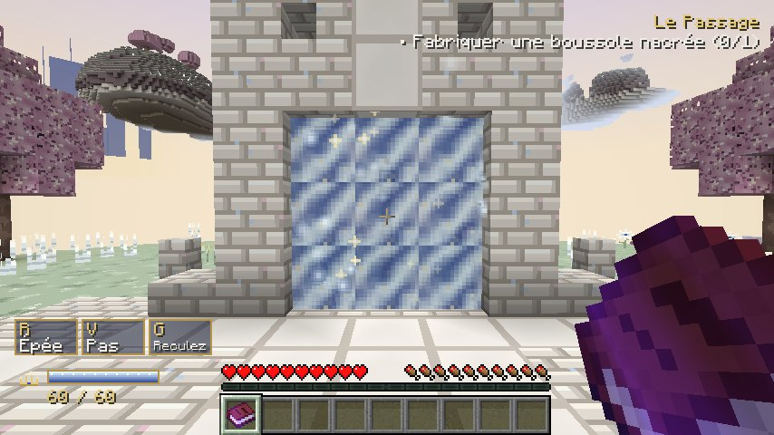
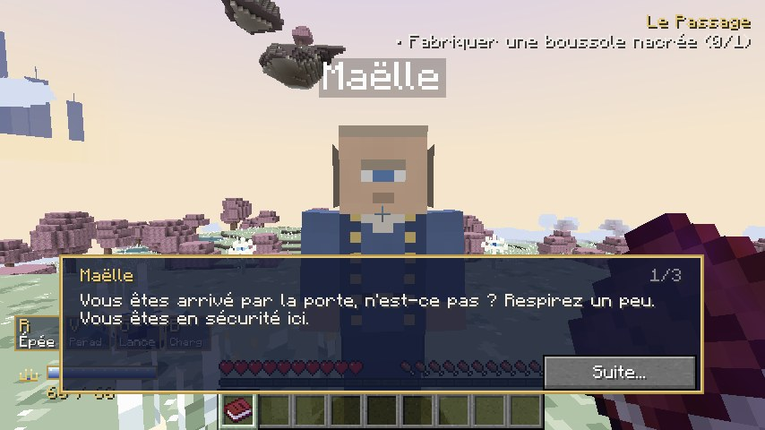
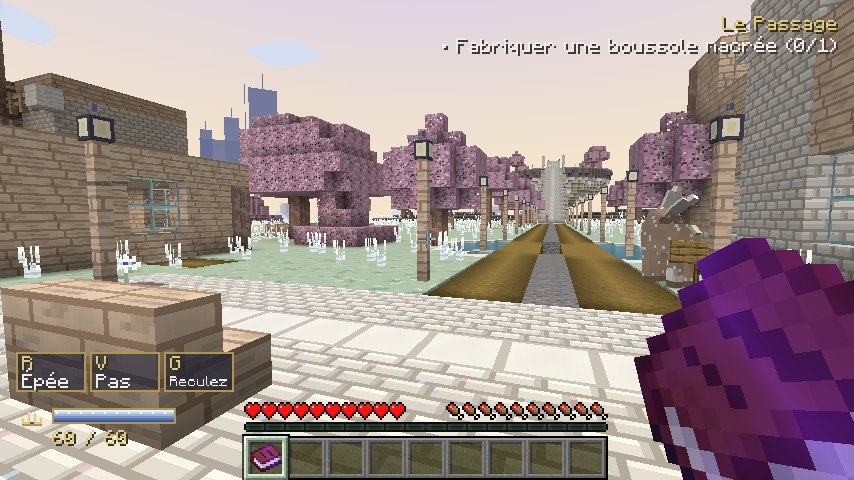
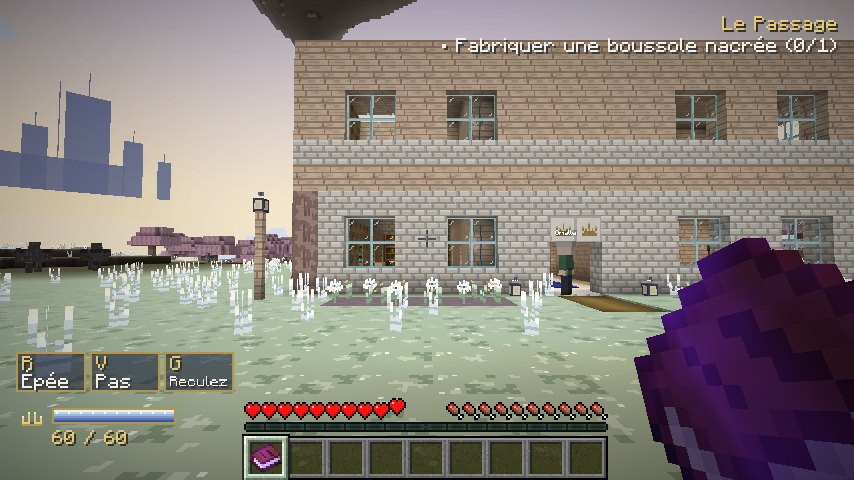
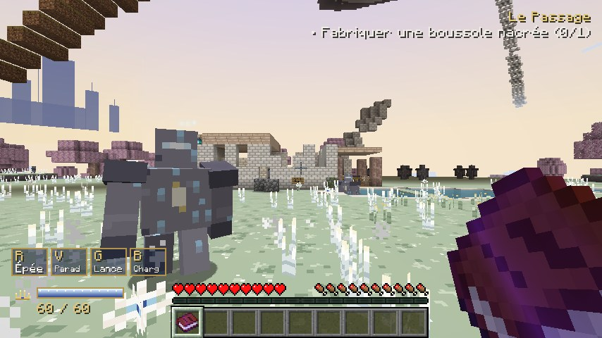
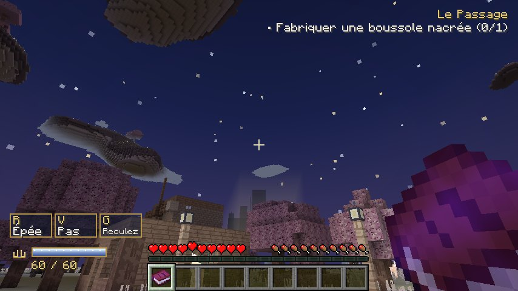

# Les Limbes

Dimension d'aventure pour **Minecraft Java 1.21.1 / Fabric**.

Tout ce qui disparaît ailleurs finit par arriver dans les Limbes : un navire perdu rejoint une mer suspendue, une bibliothèque oubliée réapparaît dans une montagne. Le joueur y découvre des prairies d'argent sous un ciel de nacre, un village accueillant, un manoir à faire revivre, une grande magie royale et, au loin, le palais de la Couronne Immobile dont le trône attend un nouveau souverain.

Le projet est développé par tranches jouables. **Cette version (0.2.0) contient la première tranche « Le Passage »** — l'entrée dans les Limbes, le Sanctuaire de l'Arrivée, Clairval, le manoir, le premier sauvetage, les premiers pouvoirs royaux et la rencontre de Vaëron — **et la tranche de qualité** : monture (raie céleste), Arrivées, mini-aventures (moulin, Lac du Crépuscule), huit quêtes secondaires. Elle n'est pas la dimension complète : voir `docs/ETAT_AVANCEMENT.md` et `docs/BACKLOG.md`.

Tout le contenu destiné au joueur est en français.

## Démarrage rapide

- Installation : `docs/GUIDE_INSTALLATION.md`
- Premiers pas sans spoiler : `docs/GUIDE_DEMARRAGE.md`
- Développement, outils et architecture : `docs/DEVELOPPEMENT.md`
- Ce qui est réellement implémenté : `docs/CATALOGUE_CONTENU.md`
- Vision, progression, backlog : `docs/VISION.md`, `docs/PROGRESSION.md`, `docs/BACKLOG.md`
- Cahier des charges de référence : `docs/CAHIER_DES_CHARGES.md`

## Compiler

Prérequis : JDK 21 (le wrapper télécharge Gradle 9.8.0).

```
./gradlew build
```

Le JAR est produit dans `build/libs/les-limbes-<version>.jar`. Il nécessite [Fabric Loader](https://fabricmc.net/use/) 0.20.0+ et [Fabric API](https://modrinth.com/mod/fabric-api) 0.116.17+1.21.1 (ou plus récent pour 1.21.1).

## Tests

```
./gradlew test          # tests unitaires (données, logique)
./gradlew runGametest   # tests de jeu sur un serveur headless (génération, porte, quêtes)
./gradlew runAutotest   # serveur dédié réel : génération des Limbes, lieux fixes, personnages (journal AUTOTEST OK/ECHEC)
./gradlew runCapture    # client avec captures d'écran automatiques (sauvegarde run/client/saves/Limbes)
./gradlew runServer     # serveur dédié de développement (run/server)
```

## Captures

Images prises par le scénario automatique (`docs/captures/`, client 1.21.1 en rendu logiciel) :

| Arche de retour du Sanctuaire | Dialogue avec Maëlle |
|---|---|
|  |  |

| Place de Clairval | Manoir du joueur |
|---|---|
|  |  |

| Relais royal et Veilleur égaré | Nuit sur Clairval |
|---|---|
|  |  |

## Licence

Code et assets originaux sous licence MIT (voir `LICENSE`). Les textures, sons et structures sont générés par les outils du dossier `tools/` qui en constituent la source.
